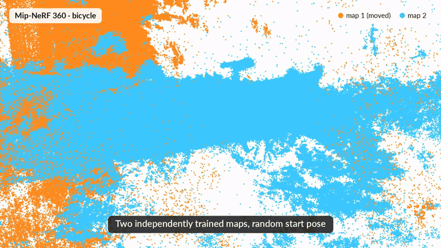
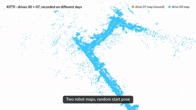
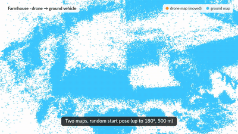
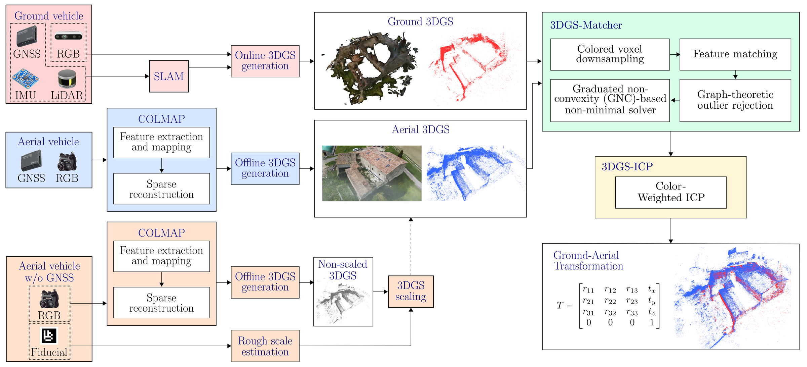

# 3DGS-Matcher

**Training-free, CPU-only registration of 3D Gaussian Splatting maps from the color the Gaussians already carry. Code of the IEEE RA-L 2026 paper.**

<p align="center">
    
</p>

<p align="center">
    
    
</p>

<p align="center">
    <a href="https://jaumealbardaner.github.io/3DGS-Matcher/"><b>Project page</b></a> &nbsp;·&nbsp;
    <a href="https://jaumealbardaner.github.io/3DGS-Matcher/dataset.html"><b>Dataset</b></a> &nbsp;·&nbsp;
    <a href="https://github.com/JaumeAlbardaner/3DGS-Matcher/tree/evaluation"><b>Evaluation code</b></a>
</p>

## Menu

  - [**System overview**](#system-overview)

  - [**Method**](#method)

  - [**Package layout**](#package-layout)

  - [**Dependencies**](#dependencies)

  - [**Install**](#install)

  - [**Run the package**](#run-the-package)

  - [**Library usage**](#library-usage)

  - [**API reference**](#api-reference)

  - [**Tuning notes**](#tuning-notes)

  - [**Troubleshooting**](#troubleshooting)

  - [**Reproducing the paper**](#reproducing-the-paper)

  - [**Paper**](#paper)

  - [**Acknowledgement**](#acknowledgement)

## System overview

<p align="center">
    
</p>

3DGS primitives are optimized for rendering, not geometric fidelity, so the shape of a single Gaussian is a weak matching cue. Across 121 trained maps, 84% of primitives have anisotropy above 0.95. 3DGS-Matcher therefore keeps the robust solver of KISS-Matcher but drives it with per-primitive photometric attributes, and then refines the pose with a color-weighted Generalized ICP.

  - **3DGS-Matcher (coarse):** ColorPFH, a relative CIELAB descriptor, plus raw RGB and opacity, on keypoints chosen by joint space-color voxelization. ROBIN prunes the correspondences and GNC estimates the pose.
  - **3DGS-ICP (fine):** GICP with geometric correspondence search, where color only re-weights each correspondence.
  - Both stages run on the CPU, need no training or rendering, and estimate a rigid SE(3) transform between maps at metric scale.


## Method

**Coarse — 3DGS-Matcher.** KISS-Matcher's solver (ROBIN correspondence pruning +
Graduated Non-Convexity pose estimation) driven by a 37-D photometric descriptor:

| Component | Dim | Notes |
|---|---|---|
| Raw RGB | 3 | absolute appearance |
| Opacity (alpha) | 1 | fourth raw channel |
| ColorPFH | 33 | 3 sub-histograms × 11 bins |
| FPFH geometry | 0 | **disabled** — not compiled in |

`ColorPFH` is the color analog of FPFH. For a keypoint *i* and each spatial neighbor
*j* within radius *r* (1 m), it summarizes the CIELAB difference
(ΔL\*, Δa\*, Δb\*), of magnitude ΔE, by three scalars:

```
α = atan2(Δb*, Δa*) / π      hue direction of the change
φ = ΔL* / ΔE                 lightness fraction
ψ = ΔE / ΔE_max              normalized magnitude   (ΔE_max = 100)
```

Each is accumulated into an 11-bin histogram and L1-normalized independently. Because
it depends only on color differences, the descriptor is rotation-invariant.

**Joint-5D keypoint selection.** Rather than keeping one representative per spatial
voxel, each Gaussian is keyed by the 5-tuple

```
( ⌊x/v⌋, ⌊y/v⌋, ⌊z/v⌋, ⌊a*/v_ab⌋, ⌊b*/v_ab⌋ )        v_ab = 5
```

One keypoint is kept per occupied 5-D cell, and spatial voxels holding fewer than two
distinct chroma bins are dropped entirely. Lightness L\* is deliberately excluded, for
robustness to exposure differences between platforms. This concentrates keypoints at
object boundaries and texture edges, where ColorPFH is most discriminative — at the
same voxel size it roughly doubles coarse success over centroid downsampling.

**Fine — 3DGS-ICP.** Correspondence search and the GICP geometric cost are left
untouched; color only re-weights each correspondence:

```
w_ik = ε + (1 − ε)·exp( −‖c_i − c_k‖² / 2σ_c² )        ε = 0.05
```

so the per-correspondence cost becomes `w_ik · rᵀ M r`. Color-inconsistent matches are
down-weighted while the optimization stays geometric, keeping the fast kd-tree search.
σ_c is calibrated automatically from the color spread of the map, since 3DGS colors
are spherical-harmonic derived and are not confined to [0, 1]. The floor ε makes the
factor degrade gracefully to plain GICP where color is uninformative.

Two alternative ways to use color are implemented and deliberately **not** used, because
both fail: a joint spatial-color nearest-neighbor search associates geometrically wrong
but similarly colored points, and appending a color residual to the ICP cost is a no-op
(color is pose-invariant, so it contributes nothing to the normal equations). See
`color_icp_factor.hpp`.

## Package layout

```
3DGS-Matcher/
├── include/3dgs_matcher/
│   ├── ColorPFH.hpp                       # relative CIELAB descriptor (α, φ, ψ)
│   ├── ColorFasterPFH.hpp                 # descriptor assembly + sRGB→CIELAB
│   ├── ColorKISSMatcher.hpp               # config + coarse pipeline
│   └── small_gicp_color/
│       ├── color_gicp_factor.hpp          # ColorWeightedGICPFactor = 3DGS-ICP
│       ├── color_icp_factor.hpp           # color-residual variants (unused, see above)
│       ├── color_registration.hpp         # align_colored / align_colored_simple
│       └── point_cloud_color.hpp          # PointCloudWithColor + small_gicp traits
├── src/
│   ├── ColorFasterPFH.cpp
│   └── ColorKISSMatcher.cpp
├── examples/
│   ├── align_two_splats.cc                # the CLI tool
│   └── splats/tramway.splat               # sample scene
├── scripts/bootstrap.sh                   # dependency + build helper
├── scripts/fetch_third_party.sh           # pinned KISS-Matcher + small_gicp
├── third_party/kiss-matcher.patch         # applied to the pinned KISS-Matcher
├── assets/                                # README figures and animations
├── gs3d_matcher_cli/                      # `uv run align_two_splats` entry point
├── pyproject.toml                         # uv setup: CMake + TBB from PyPI
└── CMakeLists.txt
```

## Dependencies

- **KISS-Matcher** (required) — provides the ROBIN matcher, GNC solver and kd-tree
- **robin** (required) — pulled in by KISS-Matcher
- **Eigen 3** (required, `<4`)
- **TBB** (required) — parallelism
- **small_gicp** (optional) — enables `--refine`; without it the build is coarse-only
- **PCL** (optional) — enables `--viz`

## Install

Two setups give the same binary, `build/align_two_splats`. Pick one.

### Option A: uv (no conda)

Needs only a C++17 compiler, `make`, `git` and the Eigen 3 headers from the system
(`sudo apt install build-essential git libeigen3-dev`, or `brew install eigen`).
[uv](https://docs.astral.sh/uv/) supplies CMake and TBB from PyPI.

```bash
git clone https://github.com/JaumeAlbardaner/3DGS-Matcher.git
cd 3DGS-Matcher
uv run align_two_splats examples/splats/tramway.splat examples/splats/tramway.splat \
    --perturb-rotation 180 --perturb-translation 500 --seed 1
```

The first call fetches the pinned KISS-Matcher and small_gicp, builds the tool (a few
minutes) and then runs it. Later calls start immediately. Before running, it checks that
both inputs are valid 3DGS maps: a `.ply` must carry `x y z f_dc_0 f_dc_1 f_dc_2 opacity`,
and a `.splat` must be a whole number of 32-byte records. All options are passed through
unchanged, so the defaults are the configuration evaluated in the paper.
`uv run align_two_splats --rebuild ...` forces a rebuild after you change the code.

### Option B: conda (no sudo required)

```bash
conda create -n 3dgs-matcher -y
conda activate 3dgs-matcher

cd 3DGS-Matcher
./scripts/fetch_third_party.sh      # KISS-Matcher @42154f8 (+ patch), small_gicp @78f2e7a
./scripts/bootstrap.sh --conda-deps --target align_two_splats --clean
```

`fetch_third_party.sh` clones the two dependencies at the commits the paper was
evaluated with into `third_party/`, where `bootstrap.sh` finds them.

### Build from source

```bash
mkdir build && cd build
cmake .. -DCMAKE_BUILD_TYPE=Release -DBUILD_EXAMPLES=ON
make -j$(nproc)
```

CMake looks for `small_gicp` in `../small_gicp/include` first; point it elsewhere with
`-DSMALL_GICP_DIR=/path/to/small_gicp`, the `SMALL_GICP_ROOT` environment variable, or
`--small-gicp-dir` when using `scripts/bootstrap.sh`. If it is not found,
the build still succeeds and prints a warning — `--refine` is then disabled.

### Build with visualization (`--viz`)

`--viz` opens a PCL viewer showing the two clouds before and after alignment. PCL is
**optional** and is detected at configure time: without it the tool still builds and
aligns normally, and `--viz` reports

```
--viz requested, but this build has no PCL visualization support.
```

To see which build you have, look for one of these lines in the configure output:

```
-- align_two_splats: PCL visualization (--viz) enabled
-- align_two_splats: PCL not found — building without --viz
```

Install PCL, then re-run the bootstrap script.

**Conda (no sudo):**

```bash
./scripts/bootstrap.sh --conda-deps --with-pcl --target align_two_splats
```

Note that `--with-pcl` only takes effect alongside `--conda-deps` (or `--deps`) - on
its own it installs nothing.

**System packages:**

```bash
sudo apt install libpcl-dev     # Debian/Ubuntu
brew install pcl                # macOS
./scripts/bootstrap.sh --target align_two_splats
```

A system-wide PCL is still picked up when a conda environment is active, so mixing the
two is fine. Re-running the bootstrap over an existing build directory is enough -
CMake retries the failed lookup once PCL is present - and `--clean` forces the issue
if it somehow does not take.

### Use it from another project

```cmake
find_package(3dgs_matcher REQUIRED)
target_link_libraries(my_app 3dgs_matcher::3dgs_matcher)
```

or, as a subdirectory:

```cmake
add_subdirectory(path/to/3DGS-Matcher)
target_link_libraries(my_app 3dgs_matcher)
```

## Run the package

### Check the installation

```bash
./build/align_two_splats examples/splats/tramway.splat examples/splats/tramway.splat \
    --perturb-rotation 180 --perturb-translation 500 --seed 1
# or, with the uv setup:
uv run align_two_splats examples/splats/tramway.splat examples/splats/tramway.splat \
    --perturb-rotation 180 --perturb-translation 500 --seed 1
```

This moves one copy of the sample splat by a random rotation (up to 180 deg about each
axis) and translation (up to 500 m), registers it back, and ends with `PASS` and
exit code 0 when the result is within 5 deg / 0.5 m of the truth, the success criterion
of the paper. A working build recovers it to a few centimeters.

### Align two maps

```bash
./build/align_two_splats source.ply target.ply
```

Prints `T_target_source`, the rigid transform mapping source onto target. Both inputs
must already be at metric scale — the pipeline estimates SE(3) only, with no scale
component. `.splat` and `.ply` are both accepted.

```
Options:
  --voxel-size <float>   Downsampling resolution in meters (default: 0.5)
  --min-alpha <0..1>     Drop splats with alpha below this (default: 0.0)
  --refine <mode>        none | gicp | color-gicp   (default: color-gicp)
  --centroid             Centroid downsampling instead of joint-5D (weaker baseline)
  --no-opacity           Drop opacity from the descriptor (36-D: RGB + ColorPFH)
  --voxel-ab <float>     Joint-5D chroma bin size in CIELAB a*/b* units (default: 5)
  --min-color-bins <int> Drop spatial voxels with fewer distinct chroma bins (default: 2)
  --cpfh-radius <float>  ColorPFH neighborhood radius in meters (default: 1.0)
  --num-max-corr <int>   Max correspondences passed to the solver (default: 5000)
  --perturb-rotation <deg>    Move the source by a random rotation of up to +-deg
  --perturb-translation <m>   ... and a random translation of up to +-m, then
                              report the error against that known transform
  --seed <int>                RNG seed for the perturbation (default: 42)
  --viz                  Before/after 3D viewer (requires a PCL build)
  -h, --help
```

The defaults are the configuration evaluated in the paper; change them only to
reproduce an ablation or to adapt to maps of a very different scale.

`--min-alpha` matters on real captures. Drone reconstructions accumulate near-transparent
floater Gaussians that swamp keypoint selection: unfiltered clouds can fail to match at
every voxel size, while the same scene filtered matches quickly and correctly. Clean
synthetic scenes need no filtering.

## Library usage

```cpp
#include <3dgs_matcher/ColorKISSMatcher.hpp>

std::vector<Eigen::Vector3f> src_points, tgt_points;   // XYZ
std::vector<Eigen::Vector4f> src_colors, tgt_colors;   // RGBA in [0,1]

// Published configuration: 37-D descriptor, joint-5D keypoints, 0.5 m voxel.
gs3d_matcher::ColorKISSMatcherConfig cfg(
    /*voxel_size=*/0.5f,
    /*use_voxel_sampling=*/true,
    /*use_quatro=*/false,
    /*thr_linearity=*/1.0f,
    /*num_max_corr=*/5000,
    /*color_weight=*/1.0f,
    /*use_color=*/true, /*use_opacity=*/true,
    /*use_centroid_voxel=*/true,
    /*use_joint_5d=*/true,
    /*voxel_size_ab=*/5.0f,
    /*min_color_bins=*/2,
    /*use_color_pfh=*/true, /*color_pfh_radius=*/1.0f,
    /*color_pfh_bins=*/11, /*color_pfh_max_de=*/100.0f);

gs3d_matcher::ColorKISSMatcher matcher(cfg);
const auto solution = matcher.estimate(src_points, tgt_points, src_colors, tgt_colors);

if (solution.valid) {
  Eigen::Matrix3d R = solution.rotation;
  Eigen::Vector3d t = solution.translation;
  std::cout << "inliers: " << matcher.getNumInliers() << "\n";
}
```

Color-weighted refinement, warm-started from the coarse pose:

```cpp
#include <3dgs_matcher/small_gicp_color/color_registration.hpp>

Eigen::Isometry3d coarse_T = Eigen::Isometry3d::Identity();
coarse_T.linear()      = solution.rotation;
coarse_T.translation() = solution.translation;

auto result = small_gicp::align_colored_simple(
    tgt_points, tgt_colors, src_points, src_colors,
    /*downsampling_resolution=*/0.5,
    /*color_weight = sigma; <= 0 requests auto-calibration=*/ -1.0,
    /*registration_type=*/"GICP_DEW",
    coarse_T);

Eigen::Isometry3d T = result.T_target_source;
```

Pass `-1.0` for the sigma unless you know your color scale. A fixed sigma against
SH-derived colors can crush every weight to ~0, at which point the optimizer quits at
iteration 0.

### Loading .splat files

```cpp
struct GaussianSplat {
  Eigen::Vector3f position;
  Eigen::Vector4f color_rgba;  // RGBA normalized to [0,1]
};
```

The 32-byte format is position (3f) + scales (3f) + RGBA (4B) + rotation (4B). For
`.ply` 3DGS files, color comes from the SH DC term as `0.28209·f_dc + 0.5`, clamped to
[0, 1]. See `examples/align_two_splats.cc` for a complete loader covering both.

## API reference

**`gs3d_matcher::ColorKISSMatcher`**
- `estimate(src_pts, tgt_pts, src_colors, tgt_colors)` → `RegistrationSolution`
  (`.valid`, `.rotation`, `.translation`)
- `match(...)` → `KeypointPair`, correspondences only
- `getNumInliers()`, `getSrcProcessed()`, `getTgtProcessed()`,
  `getSrcProcessedColors()`, `getTgtProcessedColors()`
- `reset()`, `resetSolver()`, `clear()`, `print()`

**`gs3d_matcher::ColorKISSMatcherConfig`** — extends `kiss_matcher::KISSMatcherConfig`
with `color_weight_`, `use_color_`, `use_opacity_`, `use_centroid_voxel_`,
`use_joint_5d_`, `voxel_size_ab_`, `min_color_bins_`, `use_color_pfh_`,
`color_pfh_radius_`, `color_pfh_bins_`, `color_pfh_max_de_`.

**`gs3d_matcher::ColorFasterPFH`** — descriptor assembly. Call `setInputCloud()` then
`setColorAttributes()` before `ComputeFeature()`; colors must match the cloud in size.
The same header also declares the free function `gs3d_matcher::rgbToLab()`
(sRGB → linear → XYZ D65 → CIELAB).

**`small_gicp::align_colored_simple(...)`** — preprocessing plus registration in one
call. `registration_type` selects the factor; `"GICP_DEW"` is 3DGS-ICP.

## Tuning notes

- **`--voxel-size`** trades accuracy for time. Accuracy saturates below 0.5 m while
  runtime grows steeply, so 0.5 m is the operating point; the color-weighted refinement
  adds under ~2 s at any resolution.
- **`color_weight`** scales the raw RGB, opacity and ColorPFH entries of the descriptor
  relative to each other. 1.0 is the validated default.
- **Where it fails, it fails legibly.** Scenes dominated by repeated structure with
  little color variation deny the descriptor the cue it depends on. That is the natural
  boundary of a color-driven approach, not a tuning problem.

## Troubleshooting

**Build problems:**

- `Could not find a package configuration file provided by "TBB"` → re-run with
  `--deps` (dependency install now includes `tbb-devel`).
- `Could not find a package configuration file provided by "kiss_matcher"` → run
  `scripts/fetch_third_party.sh` first, then re-run the bootstrap without
  `--skip-kiss-build`, so KISS-Matcher is built and locally installed.
- `Eigen3Config.cmake ... version: 5.x not accepted for requested 3.3` → re-run with
  `--deps`; this branch pins Eigen to `<4` and patches the KISS config automatically.

**Runtime problems:**

**"Color attributes not set"** — call `setColorAttributes()` before `ComputeFeature()`.

**Size mismatch** — points and colors must have equal length; `setColorAttributes()`
throws otherwise.

**`--viz` prints "this build has no PCL visualization support"** - PCL was not found
when the build was configured. Install it and re-run CMake; see
[Build with visualization](#build-with-visualization---viz).

**`--refine` silently does nothing** — the build did not find `small_gicp`. Re-run CMake
and check for the `align_two_splats: small_gicp not found` warning.

**Coarse stage returns `valid=NO` on a real capture** — try `--min-alpha 0.1` or higher.
Near-transparent floaters dominate keypoint selection on unfiltered drone reconstructions.

**Results vary slightly between identical runs** — the parallel sort tie-break in
`downsampleJoint5D` can change which point represents a given (voxel, chroma) cell. On
well-conditioned pairs this is immaterial; on marginal ones it can flip a run.

## Reproducing the paper

This branch holds the **library and CLI only**. The benchmark harnesses, ablation drivers, baseline runners and the data behind every table of the paper are on the [`evaluation`](https://github.com/JaumeAlbardaner/3DGS-Matcher/tree/evaluation) branch, which reproduces them with `uv run reproduce`.

## Paper

If you use this code, please cite:

**PLACEHOLDER UNTIL FINAL TEXT IS ACCEPTED**

```bibtex
@article{albardaner2026_3dgsmatcher,
  title={3DGS-Matcher: Revisiting Color-Centric Registration for 3D Gaussian Splats},
  author={Albardaner i Torras, Jaume and Auger, F{\'e}lix and Lanthier, Fr{\'e}d{\'e}rick and Santamaria-Navarro, {\`A}ngel},
  journal={IEEE Robotics and Automation Letters},
  year={2026}
}
```

It builds on KISS-Matcher, which provides the underlying solver:

```bibtex
@inproceedings{lim2025kiss,
  title={KISS-Matcher: Fast and Robust Point Cloud Registration Revisited},
  author={Lim, Hyungtae and Kim, Daebeom and Shin, Gunhee and Shi, Jingnan and Vizzo, Ignacio and Myung, Hyun and Park, Jaesik and Carlone, Luca},
  booktitle={IEEE International Conference on Robotics and Automation (ICRA)},
  pages={11104--11111},
  year={2025}
}
```

and the 3D Gaussian Splatting work:

```bibtex
@article{kerbl20233d,
  title={3D Gaussian Splatting for Real-Time Radiance Field Rendering},
  author={Kerbl, Bernhard and Kopanas, Georgios and Leimk{\"u}hler, Thomas and Drettakis, George},
  journal={ACM Transactions on Graphics},
  volume={42},
  number={4},
  pages={139:1--139:14},
  year={2023}
}
```

## Acknowledgement

- **KISS-Matcher team** at MIT for the base registration framework
- **small_gicp** for the GICP implementation the color-weighted factor plugs into
- **3D Gaussian Splatting community** for the format and datasets

This work was partially funded by the European Union's Horizon Europe programme under Grant Agreement No. 101168042 (TRIFFID). See the [project page](https://jaumealbardaner.github.io/3DGS-Matcher/) for the full list of funders.

## License

See LICENSE.
